# Perbandingan yolo11n-seg vs yolo26n-seg pada Split 70:15:15 (VestCare)

Eksperimen segmentasi objek jalan untuk penunjang tunanetra (rompi VestCare): membandingkan **YOLO11n-seg** dan **YOLO26n-seg** pada dataset yang sama dengan hiperparameter identik, lalu mengevaluasi bobot terbaik pada split **val** dan **test**.

Perbandingan ini adalah **pengulangan** dari perbandingan sebelumnya yang memakai split 80:20. Kali ini dataset dibagi **70:15:15 (train:val:test)** sehingga ada test set yang terpisah.

Semua angka di halaman ini diambil dari log terminal run dan dari `perbandingan_ringkasan.csv` / `perbandingan_detail.csv`. Angka yang sama dapat dibangkitkan ulang dengan `scripts/laporan_perbandingan.py` (lihat bagian 11).

> **Status:** hasil ini memakai **1 seed latih (seed 0)**. Lihat bagian 7 untuk keterbatasannya.

## Ringkasan cepat

| Metrik (test) | yolo11n-seg | yolo26n-seg | Selisih (26n − 11n) |
|---|---|---|---|
| Mask mAP50-95 | 0.3001 | **0.3214** | +0.0213 |
| Mask mAP50 | 0.5668 | **0.5991** | +0.0323 |
| Box mAP50-95 | 0.378 | **0.390** | +0.012 |
| Inferensi (ms/gambar), 3 pengukuran* | 5.12 / 5.31 / 10.60 | 4.17 / 5.36 / 5.03 | −0.95 / +0.05 / −5.57 |

\*Tiga pengukuran kecepatan (skrip 07, lalu `laporan_perbandingan.py` dua kali). Hasilnya tidak konsisten (yolo11n-seg berubah dari 5.12 ke 10.60 ms), sehingga **tidak dipakai sebagai dasar kesimpulan** (bagian 6).

Pada **val**, urutannya tidak konsisten (yolo11n-seg sedikit lebih tinggi di mask mAP50-95: 0.292 vs 0.285). Selisih di test kecil dan berasal dari 1 seed, sehingga belum cukup untuk klaim yang tegas (lihat bagian 7).

## 1. Pengaturan eksperimen

| Parameter | Nilai |
|---|---|
| Model | `yolo11n-seg.pt`, `yolo26n-seg.pt` (bobot pralatih Ultralytics) |
| Kelas | pohon, lubang, orang, motor, mobil |
| Split train / val / test | 70 / 15 / 15 (2062 / 157 / 157 gambar) |
| Instance val / test | 227 / 210 |
| Epoch maksimum, patience | 100, 20 (early stopping aktif) |
| imgsz / batch | 416 / 16 |
| Seed latih | 0, `deterministic=True` |
| Optimizer | `auto` (terpilih AdamW, lr0 0.001111) |
| AMP | aktif |
| Pemilihan bobot | `best.pt` dipilih otomatis Ultralytics berdasarkan fitness **val**; test hanya dipakai untuk evaluasi akhir |
| Perangkat keras | NVIDIA GeForce RTX 3050 6GB Laptop GPU |
| Perangkat lunak | Python 3.12.10, Ultralytics 8.4.219, PyTorch 2.11.0+cu128 |

Run: 2 model × 1 seed = 2 pelatihan, masing-masing dievaluasi di val dan test.

Dataset: repositori [`vestcare-dataset`](https://github.com/talithasyahlasalsabila01/vestcare-dataset), folder `hasil/06_dataset_yolo26_70_15_15/seg/` (label polygon, `data.yaml` tersedia).

## 2. Proses pelatihan

| Model | Epoch efektif | Epoch terbaik | Waktu latih | Waktu per epoch (kira-kira) |
|---|---|---|---|---|
| yolo11n-seg | 54 | 34 | 0.295 jam (±17.7 menit) | ±16 detik |
| yolo26n-seg | 37 | 17 | 0.292 jam (±17.5 menit) | ±25 detik |

Kedua model berhenti lebih awal karena tidak ada perbaikan selama 20 epoch (patience 20). Waktu total hampir sama karena yolo26n-seg berhenti lebih cepat, padahal tiap epoch-nya lebih lama.

## 3. Hasil utama (test)

157 gambar, 210 instance.

| Model | mask P | mask R | mask F1 | mask mAP50 | mask mAP50-95 | box mAP50 | box mAP50-95 |
|---|---|---|---|---|---|---|---|
| yolo11n-seg | 0.626 | 0.591 | 0.608 | 0.5668 | 0.3001 | 0.645 | 0.378 |
| yolo26n-seg | 0.759 | 0.549 | 0.637 | 0.5991 | 0.3214 | 0.669 | 0.390 |
| Selisih (26n − 11n) | +0.133 | −0.042 | +0.029 | +0.0323 | +0.0213 | +0.023 | +0.012 |

Box P / R: yolo11n-seg 0.683 / 0.646 dan yolo26n-seg 0.612 / 0.745.
F1 dihitung dari P dan R gabungan seluruh kelas.

yolo26n-seg unggul di mask mAP50, mask mAP50-95, box mAP50, dan box mAP50-95, serta punya precision mask yang lebih tinggi. yolo11n-seg unggul di recall mask dan precision box.

## 4. Hasil pada val (untuk cek generalisasi)

157 gambar, 227 instance.

| Model | mask P | mask R | mask mAP50 | mask mAP50-95 | box mAP50 | box mAP50-95 |
|---|---|---|---|---|---|---|
| yolo11n-seg | 0.583 | 0.531 | 0.530 | 0.292 | 0.619 | 0.384 |
| yolo26n-seg | 0.602 | 0.536 | 0.529 | 0.285 | 0.619 | 0.364 |
| Selisih (26n − 11n) | +0.019 | +0.005 | −0.001 | −0.007 | 0.000 | −0.020 |

Di val, kedua model hampir setara dan yolo11n-seg sedikit lebih tinggi pada mAP50-95. Hasil ini berlawanan arah dengan test, yang menunjukkan bahwa selisih antar model berada dalam rentang noise antar split dan antar epoch.

## 5. Akurasi per kelas (test, mask)

### 5.1 yolo11n-seg

| Kelas | n gambar | n instance | P | R | mAP50 | mAP50-95 |
|---|---|---|---|---|---|---|
| pohon | 28 | 28 | 0.849 | 0.893 | 0.889 | 0.570 |
| lubang | 48 | 78 | 0.402 | 0.218 | 0.226 | 0.101 |
| orang | 18 | 26 | 0.569 | 0.462 | 0.422 | 0.211 |
| motor | 33 | 46 | 0.615 | 0.630 | 0.548 | 0.243 |
| mobil | 30 | 32 | 0.695 | 0.750 | 0.748 | 0.375 |

### 5.2 yolo26n-seg

| Kelas | n gambar | n instance | P | R | mAP50 | mAP50-95 |
|---|---|---|---|---|---|---|
| pohon | 28 | 28 | 0.958 | 0.893 | 0.943 | 0.575 |
| lubang | 48 | 78 | 0.775 | 0.179 | 0.310 | 0.129 |
| orang | 18 | 26 | 0.530 | 0.385 | 0.416 | 0.229 |
| motor | 33 | 46 | 0.708 | 0.630 | 0.607 | 0.306 |
| mobil | 30 | 32 | 0.822 | 0.656 | 0.720 | 0.368 |

### 5.3 Selisih mAP50-95 mask per kelas (yolo26n-seg − yolo11n-seg)

| Kelas | yolo11n-seg | yolo26n-seg | Selisih |
|---|---|---|---|
| pohon | 0.570 | 0.575 | +0.005 |
| lubang | 0.101 | 0.129 | +0.028 |
| orang | 0.211 | 0.229 | +0.018 |
| motor | 0.243 | 0.306 | +0.063 |
| mobil | 0.375 | 0.368 | −0.007 |

Kedua model paling kuat pada **pohon** dan **mobil**, dan paling lemah pada **lubang** (objek kecil/tipis, recall hanya 0.18–0.22). yolo26n-seg lebih tinggi di 4 dari 5 kelas, dengan selisih terbesar pada motor; yolo11n-seg sedikit lebih baik pada mobil. Jumlah instance per kelas di test kecil (26–78), sehingga angka per kelas cukup berfluktuasi.

## 6. Efisiensi

| Model | Parameter (training) | Parameter (fused) | GFLOPs @640 | GFLOPs @416 | Ukuran `best.pt` |
|---|---|---|---|---|---|
| yolo11n-seg | 2.859 juta | 2.850 juta | 9.7 | 4.08 | 6.0 MB |
| yolo26n-seg | 3.085 juta (+7.9%) | 2.705 juta | 9.1 | 3.84 | 6.6 MB |

Kecepatan inferensi pada test (RTX 3050, batch 16, rata-rata per gambar, tidak termasuk pra/pasca-proses):

| Pengukuran | yolo11n-seg | yolo26n-seg |
|---|---|---|
| Skrip `07_bandingkan_model.py` (`perbandingan_detail.csv`) | 5.12 ms | 4.17 ms |
| `laporan_perbandingan.py`, jalan ke-1 | 5.31 ms | 5.36 ms |
| `laporan_perbandingan.py`, jalan ke-2 (dengan penyimpanan grafik) | 10.60 ms | 5.03 ms |

Ketiga pengukuran memberi hasil yang berbeda-beda (yolo11n-seg berubah dari 5.12 ke 10.60 ms, sedangkan metrik akurasinya identik di setiap jalan). Pengukuran ini dipengaruhi urutan evaluasi, cache, beban proses lain, penyimpanan grafik, dan pemanasan GPU, sehingga **belum dapat disimpulkan model mana yang lebih cepat**. Untuk klaim kecepatan, perlu benchmark khusus (batch 1, pemanasan, banyak pengulangan, tanpa proses lain). Setelah di-*fuse*, yolo26n-seg memiliki parameter dan GFLOPs sedikit lebih rendah. Angka kecepatan bergantung pada perangkat keras dan tidak sebanding dengan hasil di CPU atau di GPU lain.

GFLOPs @640 berasal dari ringkasan model Ultralytics (ukuran gambar standar 640); GFLOPs @416 dihitung pada ukuran gambar yang dipakai saat pelatihan dan evaluasi.

## 7. Keterbatasan dan catatan

- **Hanya 1 seed latih** (seed 0). Selisih 0.0213 pada mask mAP50-95 dapat berubah bila seed lain dipakai. Untuk klaim yang lebih kuat, jalankan `--seeds 0,1,2` dan laporkan rata-rata ± simpangan baku.
- **Early stopping** menghentikan yolo11n-seg di epoch 54 dan yolo26n-seg di epoch 37 (terbaik di epoch 17). Kurva val per epoch naik-turun cukup besar, sehingga epoch terbaik dapat dipengaruhi noise. Mencoba `--patience 50` adalah langkah yang masuk akal.
- **Hasil val dan test tidak konsisten** (lihat bagian 3 dan 4): yolo26n-seg unggul di test, tetapi yolo11n-seg sedikit lebih tinggi di val. Karena itu, kesimpulan "yolo26n-seg lebih akurat" belum bisa dinyatakan tegas.
- **Jumlah instance kecil** (210 di test; pohon 28, orang 26, mobil 32, motor 46, lubang 78), sehingga metrik per kelas sensitif terhadap beberapa gambar.
- **Pengukuran kecepatan tidak stabil** antar skrip (bagian 6); jangan dipakai sebagai bukti bahwa salah satu model lebih cepat.
- Satu split tetap (70:15:15) dipakai; tidak ada ulangan split.
- Belum dilakukan uji statistik formal.
- Kelas **lubang** (mask mAP50-95 0.10–0.13) dan **orang** masih menjadi titik lemah.

## 8. Perbandingan dengan split 80:20 (tahap 6 sebelumnya)

Hasil berikut berasal dari repositori [`yolo11n-yolo26n-experiments-vestcare`](https://github.com/saiful-rizal/yolo11n-yolo26n-experiments-vestcare) dan **tidak dapat dibandingkan langsung** karena komposisi data, jumlah epoch, dan batch berbeda.

| Item | Split 80:20 (sebelumnya) | Split 70:15:15 (ini) |
|---|---|---|
| Epoch | 10, patience 30 | maks 100, patience 20 |
| imgsz / batch | 416 / 1 | 416 / 16 |
| Ulangan | 3 seed split | 1 seed latih |
| Mask mAP50-95 test yolo11n-seg | 0.2388 ± 0.0330 | 0.3001 |
| Mask mAP50-95 test yolo26n-seg | 0.2945 ± 0.0368 | 0.3214 |
| Selisih (26n − 11n) | +0.0557 | +0.0213 |

Arah yang sama (yolo26n-seg lebih tinggi) muncul di kedua split, tetapi selisihnya menyempit pada pelatihan yang lebih panjang (maks 100 epoch). Dengan 1 seed, penyempitan ini belum dapat dipastikan.

## 9. Grafik

### 9.1 Perbandingan model (test, mask) dan seluruh indikator

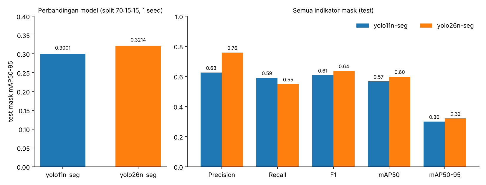

### 9.2 Akurasi per kelas (test, mask)

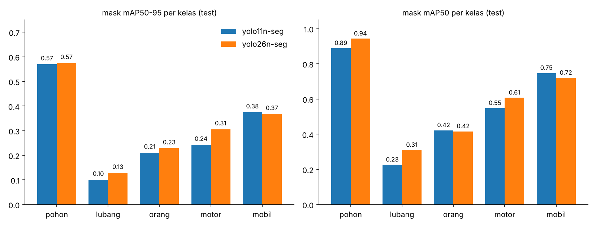

### 9.3 Konsistensi val vs test

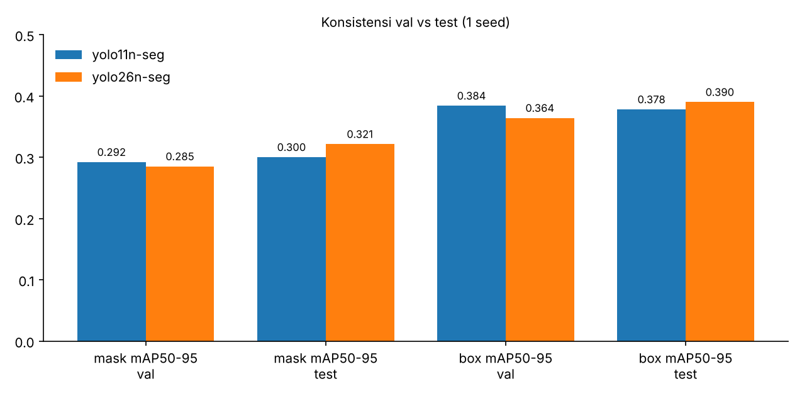

### 9.4 Efisiensi

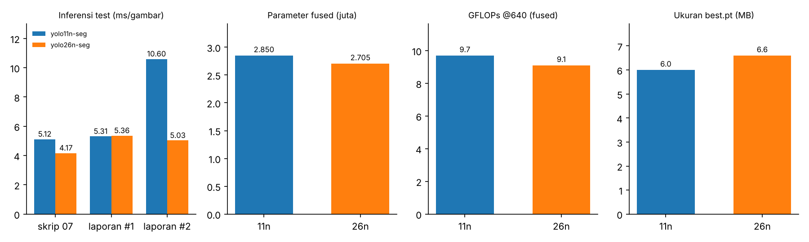

### 9.5 Confusion matrix pada test (seed 0)

| yolo11n-seg | yolo26n-seg |
|---|---|
| 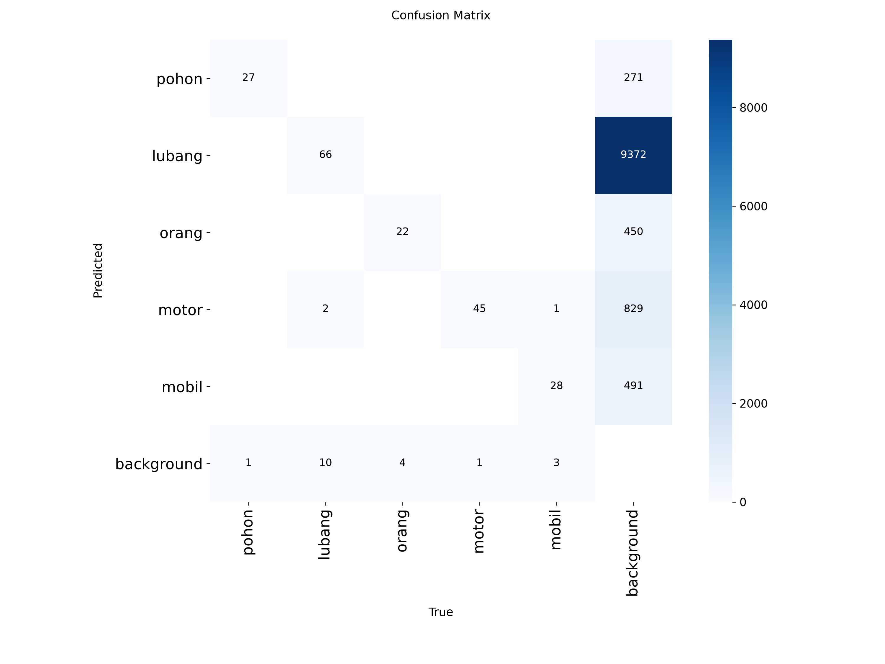 | 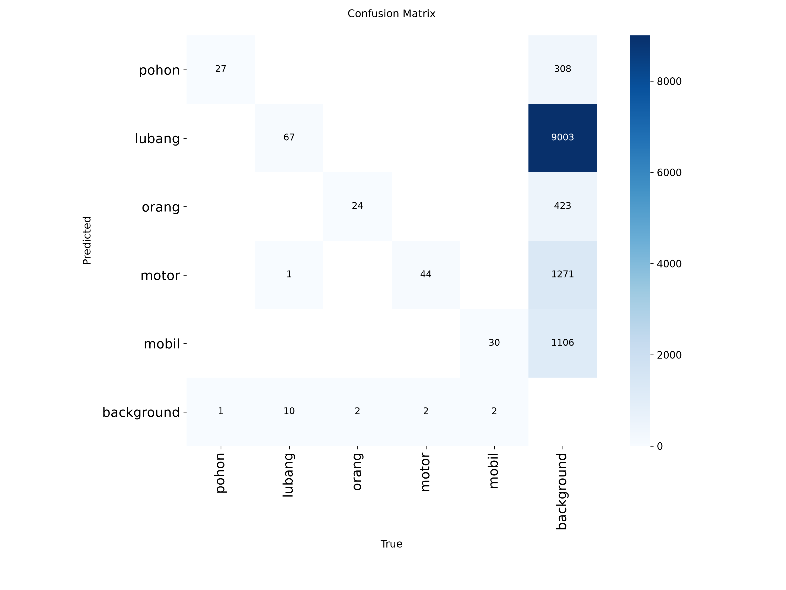 |

### 9.6 Kurva PR mask pada test (seed 0)

| yolo11n-seg | yolo26n-seg |
|---|---|
| 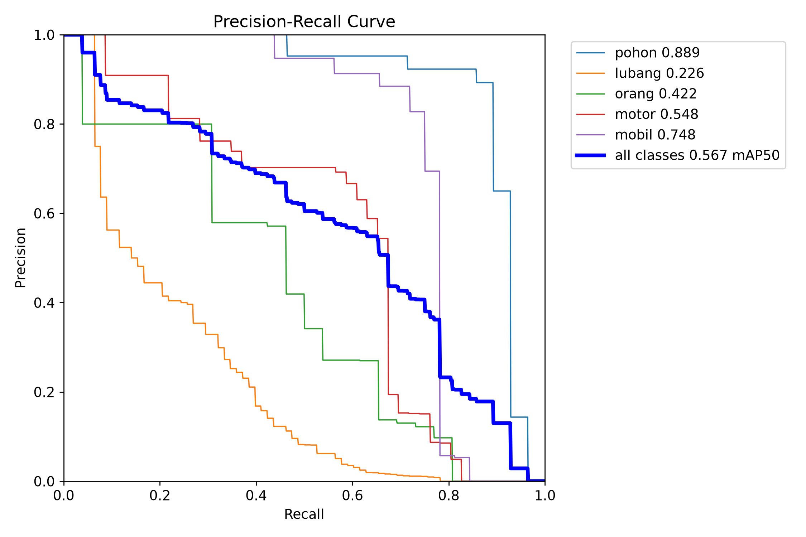 | 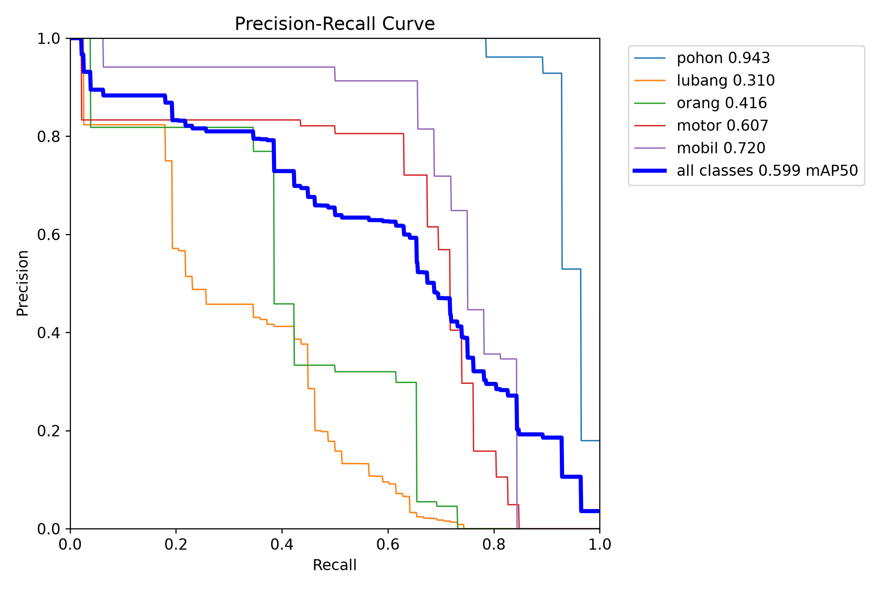 |

### 9.7 Kurva F1 mask pada test (seed 0)

| yolo11n-seg | yolo26n-seg |
|---|---|
| 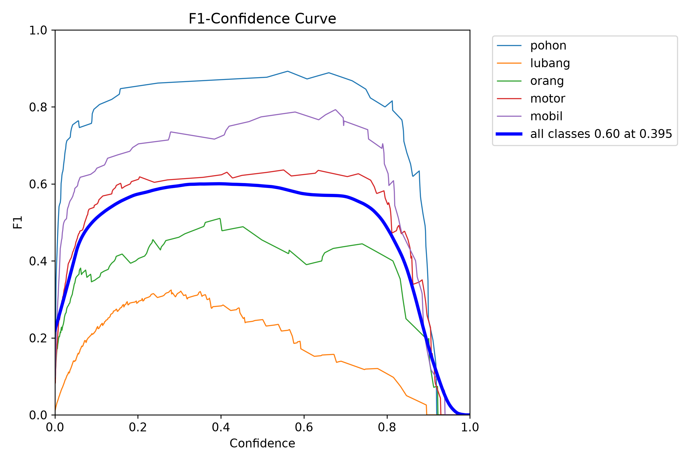 | 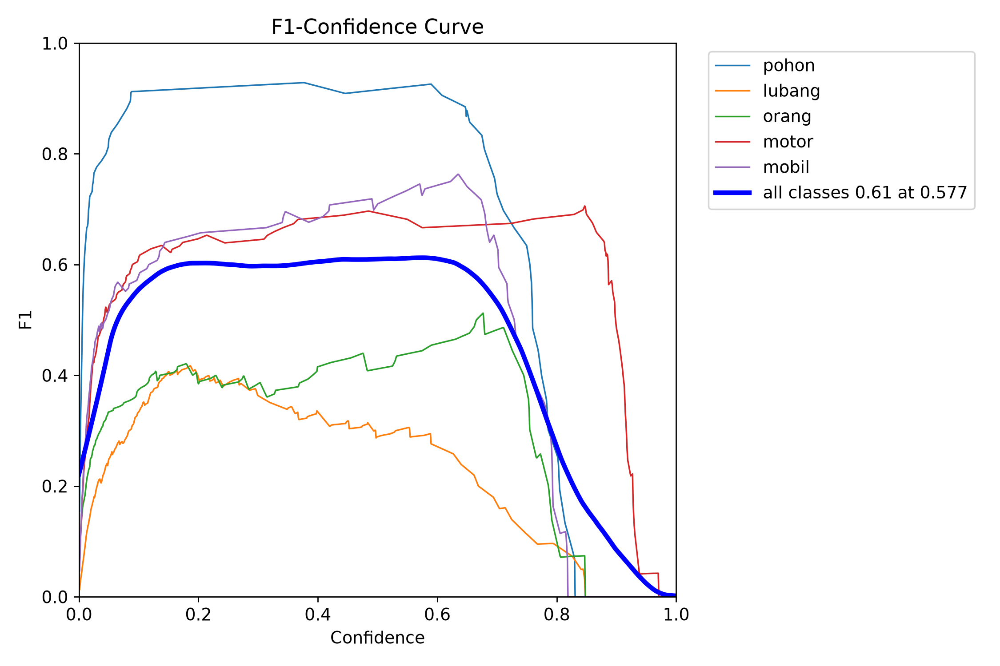 |

### 9.8 Kurva latih (results.png dari Ultralytics)

| yolo11n-seg | yolo26n-seg |
|---|---|
| 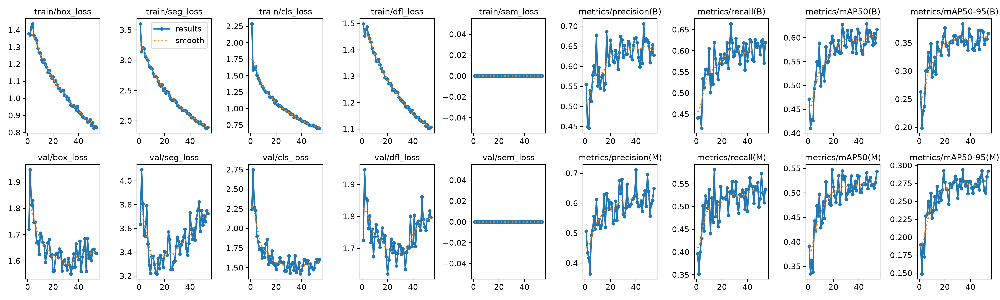 | 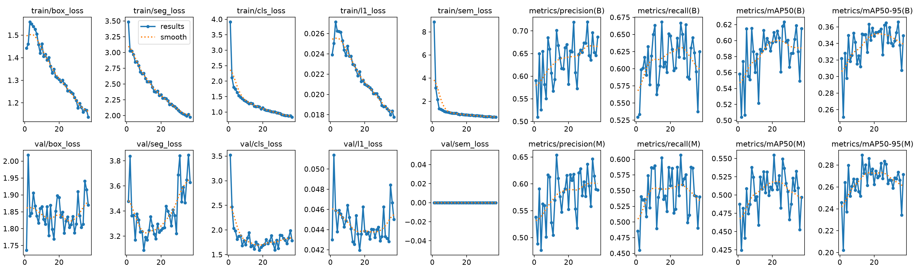 |

Grafik 9.1-9.4 dibuat dari angka di tabel README ini (`grafik/buat_grafik.py`). Grafik 9.5-9.7 dibuat Ultralytics saat evaluasi split **test** oleh `scripts/laporan_perbandingan.py`. Grafik lain (kurva P/R/F1 box, versi ternormalisasi) ada di `grafik/test/<run>/`.

## 10. Struktur repo

```
README.md
grafik/
  perbandingan_model.png, per_kelas.png, val_vs_test.png, efisiensi.png
  buat_grafik.py                  pembuat grafik 9.1-9.4
  test/yolo11n_seed0/, test/yolo26n_seed0/   confusion matrix, kurva PR dan F1 (split test)
scripts/
  07_bandingkan_model.py          latih + evaluasi model (val & test), keluaran CSV ringkasan
  laporan_perbandingan.py         laporan txt + CSV per kelas dari run yang sudah ada
  config.py, util.py              pengaturan dan fungsi bantu yang dipakai skrip 07
hasil/07_perbandingan_model/70_15_15/
  perbandingan_detail.csv         1 baris per run (model x seed)
  perbandingan_ringkasan.csv      rata-rata antar seed per model
  laporan_perbandingan.txt        laporan lengkap val & test
  perbandingan_per_kelas_lengkap.csv   P/R/mAP per kelas (box & mask)
  seg/yolo11n_seed0/              results.csv, args.yaml, grafik, weights/best.pt
  seg/yolo26n_seed0/              results.csv, args.yaml, grafik, weights/best.pt
```

Dataset (sekitar 900 MB) **tidak** disertakan di repo ini. Dataset ada di repositori [`vestcare-dataset`](https://github.com/talithasyahlasalsabila01/vestcare-dataset), folder `hasil/06_dataset_yolo26_70_15_15/`.

## 11. Menjalankan ulang

Clone dataset, lalu letakkan folder `hasil/06_dataset_yolo26_70_15_15/` di dalam repo ini (atau tunjukkan lokasinya dengan `--dataset`).

Gunakan virtual environment dengan PyTorch versi CUDA agar GPU terpakai (contoh untuk CUDA 12.8):

```powershell
pip install -U ultralytics matplotlib
pip uninstall -y torch torchvision
pip install torch torchvision --index-url https://download.pytorch.org/whl/cu128
python -c "import torch; print(torch.cuda.is_available())"   # harus True
```

Latih dan bandingkan (1 seed, sesuai hasil di atas):

```powershell
cd scripts
python 07_bandingkan_model.py --mode seg --models yolo11n,yolo26n --seeds 0 --epochs 100 --imgsz 416 --batch 16 --device 0
```

Untuk hasil yang lebih kuat, gunakan 3 seed dan patience lebih besar:

```powershell
python 07_bandingkan_model.py --mode seg --models yolo11n,yolo26n --seeds 0,1,2 --epochs 100 --imgsz 416 --batch 16 --patience 50 --device 0
```

Buat laporan txt dan CSV per kelas dari run yang sudah ada (tanpa training ulang):

```powershell
python laporan_perbandingan.py --device 0 --data <path ke seg/data.yaml>
```

Jika terputus saat training, tambahkan `--resume`.

## 12. Kesimpulan

- Pada split 70:15:15 dengan 1 seed, **yolo26n-seg sedikit lebih akurat di test**: mask mAP50-95 0.3214 vs 0.3001 (+0.0213) dan mask mAP50 0.5991 vs 0.5668.
- Di **val**, kedua model setara dan yolo11n-seg sedikit lebih tinggi pada mAP50-95, sehingga keunggulan yolo26n-seg **belum konsisten** dan belum dapat dinyatakan secara tegas.
- Kecepatan inferensi **belum dapat disimpulkan**: tiga pengukuran memberi hasil berbeda-beda (bagian 6). yolo26n-seg sedikit lebih ringan setelah di-*fuse* (2.705 vs 2.850 juta parameter), dengan ukuran bobot sedikit lebih besar (6.6 vs 6.0 MB).
- Arah hasil sama dengan perbandingan split 80:20 (yolo26n-seg lebih tinggi), tetapi selisihnya lebih kecil.
- Kelas **lubang** dan **orang** masih lemah di kedua model dan menjadi kandidat perbaikan (augmentasi, anotasi, atau resolusi lebih tinggi).
- Langkah berikutnya: tambah seed (`0,1,2`), naikkan patience, lalu laporkan rata-rata ± simpangan baku.
